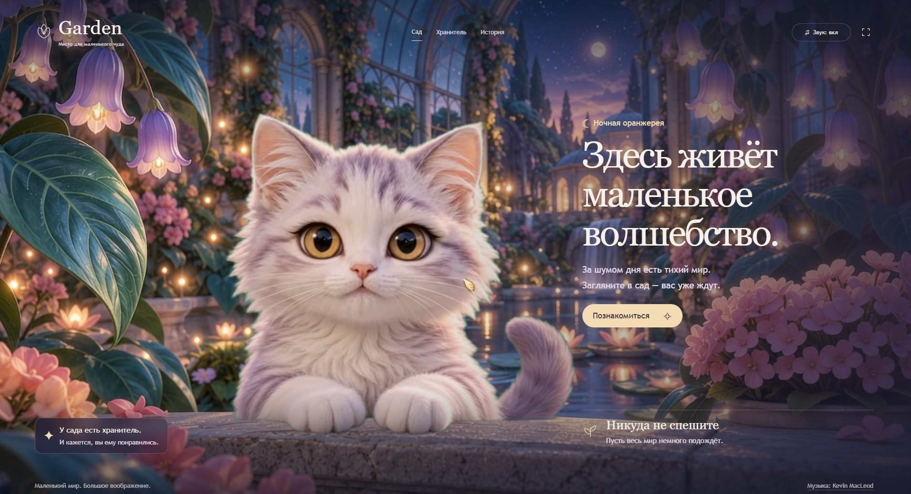

# Garden

Интерактивная главная страница сказочной оранжереи. Кот поворачивается в сторону курсора, отдыхает в центре и приветствует посетителя по нажатию. За ним живёт отдельный анимированный сад: вода, цветы и мягкий вечерний свет.

**Независимое портфолио-демо Артура Колесникова.** Вымышленный сайт; не коммерческий заказ и не действующий сервис.



[Посмотреть видеодемо в портфолио](https://arturkolesnikov.online/#work) · [Скачать запись, 34 секунды](docs/garden-demo.mp4)

## Взаимодействие

- Движение курсора выбирает одно из восьми направлений взгляда. Голова проходит промежуточные положения по кругу.
- Нажатие на кота или «Познакомиться» запускает приветствие после завершения текущего движения и возврата в центр.
- В центре проигрывается живая анимация с дыханием и морганием.
- «Войти в Garden» включает тихую музыку и звук приветствия. Кнопка «Звук» выключает оба; музыка не приглушается во время мяуканья.
- «История» открывает небольшой рассказ о саде, кнопка в правом верхнем углу переключает полноэкранный режим.
- Курсор отрисовывается внутри страницы, поэтому виден при записи вкладки.

## Как это устроено

Vanilla JavaScript, HTML, CSS и WebGL. Фон и персонаж декодируются отдельно; шейдер убирает зелёный фон кота и смешивает края с окружением. Контроллер выбирает видеопереходы между направлениями, сохраняет последний кадр до готовности следующего видео и восстанавливает декодер после ошибки перемотки.

Это интерактивная композиция из заранее подготовленных видео, а не управляемая в реальном времени 3D-модель. Направления дискретные; дальний поворот занимает время. Исходные ролики — 1280 × 720, 24 кадра/с. Полноэкранное отображение не добавляет детализации исходникам.

## Запуск

Нужен Python 3.10 или новее. Зависимостей и сборки нет.

```bash
git clone https://github.com/famelikolbut5/garden.git
cd garden
python serve.py
```

Откройте <http://127.0.0.1:8819>. Сервер работает только локально и поддерживает HTTP Range для перемотки видео. Для публикации файлов нужен обычный статический хостинг с поддержкой Range-запросов.

## Структура

```text
index.html       Сцена и элементы главной страницы
style.css        Оформление и адаптивная композиция
app.js           Видео, маршруты переходов, WebGL и звук
showcase.js      Вход, навигация, курсор и полноэкранный режим
layers/          Видео персонажа, фон и аудио
docs/            Скриншот и видеозапись демо
serve.py         Локальный сервер с HTTP Range
ATTRIBUTION.md   Авторы, источники и лицензия музыки
```

## Доступность и ограничения

Есть управление с клавиатуры: стрелки — направления, Home — прямо, Enter на сцене — приветствие. Диалоги закрываются Escape; кнопки имеют видимый фокус. При `prefers-reduced-motion` сцена остаётся статичной. Для записи анимации эту системную настройку нужно отключить.

Для воспроизведения нужны WebGL и декодирование H.264. Плавность зависит от браузера и устройства; качество исходных кадров и дискретные направления ограничивают точность взгляда. При ошибке декодирования предусмотрена попытка восстановления.

## Материалы и авторство

Музыка — **Fairytale Waltz, Kevin MacLeod**, CC BY 4.0. Полное указание авторства, ссылки и изменения: [ATTRIBUTION.md](ATTRIBUTION.md).

Изображения и исходные видео получены с помощью генеративных инструментов. Интерфейс, композиция и программное взаимодействие подготовлены для этого демо. Музыка не является авторской работой разработчика. Лицензия музыки не распространяется автоматически на код или другие материалы проекта.

Для основного портфолио предусмотрена видеозапись демо: интерактивный движок и набор исходных клипов на лендинг не переносим.


Код распространяется по [лицензии MIT](LICENSE). Музыка и другие медиаматериалы имеют отдельные условия, указанные в [ATTRIBUTION.md](ATTRIBUTION.md).
